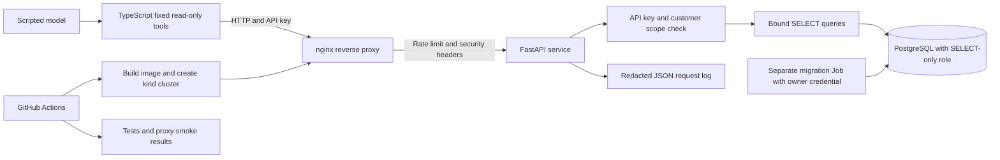

# ai-agent-api-k8s

[](https://github.com/hamza2829/ai-agent-api-k8s/actions/workflows/ci.yml)

A learning project showing a constrained AI tool interface, a read-only customer API and deployment through nginx in Kubernetes. All customer names, orders and invoices are fake. The model is scripted, so no paid AI API or API key for a model is needed.

## Architecture



The TypeScript tools can call four fixed GET routes. They cannot choose arbitrary URLs, methods or headers. The API checks the key and its allowed customer independently of the model. PostgreSQL's runtime role can SELECT the three data tables and cannot insert, update or delete them. SQL migration ownership is separate from runtime access.

The scripted-agent end-to-end test exercises a real HTTP API over PostgreSQL in CI. The proxy smoke test separately verifies the deployed service through nginx in kind. Local sandbox tests use SQLite and do not establish PostgreSQL permissions or Kubernetes behavior.

## Endpoints and fake data

| Endpoint | Purpose |
| --- | --- |
| `GET /health` | Liveness, no database query |
| `GET /ready` | Readiness, executes SELECT 1 |
| `GET /v1/customers/{customer_id}` | Customer ID, fake name and tier |
| `GET /v1/customers/{customer_id}/orders` | Bounded order list with optional status |
| `GET /v1/customers/{customer_id}/invoices` | Bounded invoice list with optional status |
| `GET /v1/customers/{customer_id}/summary` | Counts and outstanding integer cents |

Customer IDs use `cus_001` format. Lists accept `limit` from 1 to 20 and `offset` from 0 to 1000. Orders accept pending, shipped or cancelled; invoices accept open, paid or overdue. Money is stored as integer cents. There are 2 fake customers, 4 orders and 4 invoices. The demo key is scoped to cus_001, which has 3 orders and 3 invoices. Access to cus_002 is rejected with 403.

Authentication uses `X-API-Key`. Missing or invalid keys return 401. Invalid inputs return 422, out-of-scope customers 403, missing in-scope customers 404, rate-limited requests 429 and database failures 503. No write endpoint exists.

## Run locally without Docker

Requirements: Python 3.12, Node.js 22 and npm. Docker and kubectl are not needed for local unit tests or the scripted sandbox demonstration.

From the repository root on Windows PowerShell:

```powershell
py -3.12 -m venv .venv
.\.venv\Scripts\python.exe -m pip install -e ".[dev]"
npm ci --prefix agent
.\.venv\Scripts\python.exe -m pytest -q
npm test --prefix agent
```

Without `TEST_DATABASE_URL`, PostgreSQL checks are explicitly skipped. Without `API_BASE_URL`, the real-HTTP TypeScript E2E test is explicitly skipped. Unit tests still run. The local SQLite fixture is not the production database or a substitute for the PostgreSQL integration tests.

For a local scripted call, start the sandbox in terminal 1:

```powershell
$env:API_KEY = "demo-only-key-change-me-123456"
.\.venv\Scripts\python.exe -m uvicorn agent_api.local_demo:app --host 127.0.0.1 --port 8080 --no-access-log
```

In terminal 2:

```powershell
$env:API_KEY = "demo-only-key-change-me-123456"
$env:API_BASE_URL = "http://127.0.0.1:8080"
npm run demo --prefix agent
npm run test:e2e --prefix agent
```

The demo key is deliberately public, fake and unusable outside this disposable demo. The API never reads it from model arguments. On Linux/macOS use `.venv/bin/python` and shell `export` syntax. In restricted Windows environments, pytest may need `--basetemp .pytest-temp` and loopback networking permission.

For actual PostgreSQL, install PostgreSQL locally or use a disposable development server. Set an owner `DATABASE_URL` and `READ_DB_PASSWORD`, then run `python -m agent_api.migrate --demo-bootstrap`. Use `postgresql+psycopg://agent_reader:<reader-password>@localhost:5432/customer_demo` as the API's DATABASE_URL after migration. Never use the migration owner's credential in the running API. Full commands are in [docs/STEPS.md](docs/STEPS.md).

## Data and migrations

[001_schema.sql](migrations/001_schema.sql) creates customers, orders and invoices, with constraints and indexes. A composite foreign key prevents invoices from pointing at another customer's order. [002_demo_seed.sql](migrations/002_demo_seed.sql) inserts only invented data.

The migration runner uses a transaction, PostgreSQL advisory lock and a version/checksum table. Re-running it does not duplicate rows. Changing an already-applied migration raises an error; add a new migration instead. This demo has forward migrations only. The bootstrap step grants SELECT only on the three data tables and defaults the reader role to read-only transactions. Tests explicitly try write transactions to check that missing table privileges still prevent writes.

## Agent interface

[agent/src/tool-schemas.json](agent/src/tool-schemas.json) defines `get_customer`, `list_orders`, `list_invoices` and `customer_summary`. [agent/src](agent/src) validates the complete argument object before any request, rejects unknown properties, constrains IDs, pagination and statuses, uses fixed routes, refuses redirects and sets a timeout. Errors are mapped to short messages without including the API key or upstream response bodies.

The scripted model requests the first two orders for cus_001. The executor calls the real service and the scripted follow-up checks the returned fake data. This verifies tool wiring and boundary checks. It does not measure a language model's reasoning, prompt-injection resistance or general accuracy.

## Kubernetes and nginx

[deploy/](deploy) uses kustomize and contains API, nginx and PostgreSQL Deployments/Services, ConfigMaps, an explicitly fake demo Secret, probes, resource requests/limits and a separate migration Job. The API runs as non-root with a read-only container filesystem. Only nginx is exposed through the kind node port; the API and PostgreSQL Services are ClusterIP.

nginx forwards to FastAPI, applies an IP-based request limit and adds security headers on success and errors. Health routes are exempt from proxy rate limiting so probes remain stable. The API also applies a key-based 60-request sliding window. These are separate protections. See [deploy/nginx.conf](deploy/nginx.conf).

GitHub Actions builds the image on its hosted runner, creates kind, loads the image, starts PostgreSQL, completes migrations, waits for API/proxy readiness, then calls the proxy. It uploads test results, API logs, smoke JSON, pod status, events and container logs even after failures. No Docker command runs on your local machine as part of the documented path.

## Results

The implementation is being verified. The current local Python result is 34 passed tests; 6 real PostgreSQL checks require CI. All 40 TypeScript tests, including actual HTTP against the local SQLite sandbox, passed. Details are recorded in [docs/RESULTS.md](docs/RESULTS.md). This section will be updated with actual remote counts and proxy outcomes after the first CI run. The badge reports GitHub's current workflow state, not a fabricated result.

## Limits and what I would change

- The kind deployment uses HTTP, without TLS. The public demo key is unsuitable for any real deployment. I would put TLS and a managed identity/OAuth policy in front of a real service.
- The committed Secret contains only published fake demo values. Kubernetes Secret base64 storage is not a secret-management system. I would use external secret management, rotation and encrypted storage with proper access controls.
- There is one API replica and no autoscaling. The application rate limiter is in process and is not shared across replicas or restarts. I would use a distributed limiter before scaling.
- PostgreSQL storage is ephemeral in this demo, with no backups or high availability. This deployment is for an expendable kind cluster, not production customer data.
- ClusterIP limits exposure, but does not itself isolate traffic inside the cluster. There is no NetworkPolicy or per-agent workload identity.
- One API key maps to one configured customer allowlist. There is no key issuance, rotation, per-user role system or audit log retention policy.
- Request logs omit keys, query strings and response data. They are application logs, not a tamper-resistant audit trail. Health requests are logged too and need sampling or separate retention in a real service.
- Tool allowlisting does not solve model hallucination or prompt injection generally. This project uses a scripted model and intentionally limited reads.
- Migrations are forward-only and the schema is intentionally small. There is no zero-downtime migration strategy, invoice accounting logic or production domain model.

## Reproduction and screenshots

Follow [docs/STEPS.md](docs/STEPS.md) in order. It names the screenshot to take after each meaningful check. Screenshots are a checklist until you capture them from real runs. CI logs and artifacts provide machine-generated evidence separately.
